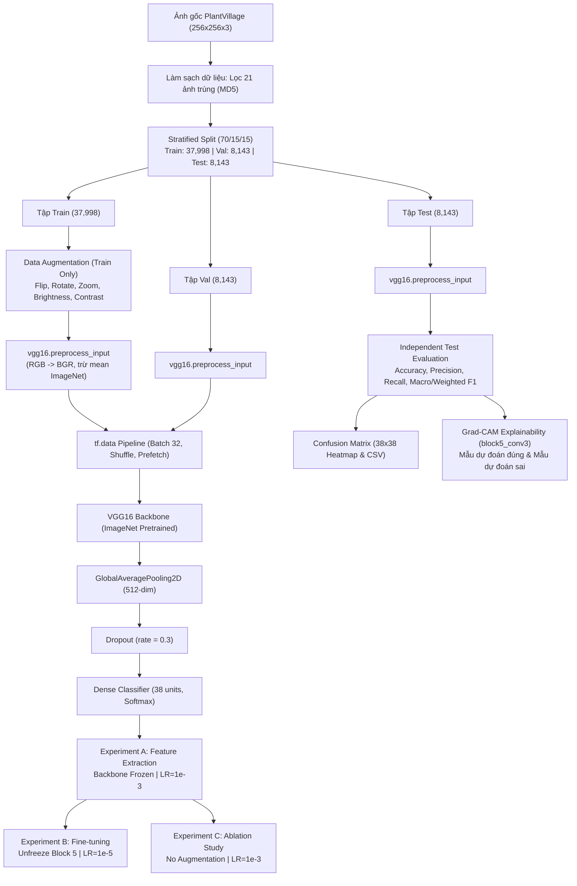

# 🌿 Báo Cáo Kỹ Thuật: Pipeline Thực Nghiệm VGG16 Cho Phân Loại Bệnh Cây Trồng PlantVillage

**Dự án:** Phân loại bệnh cây trồng bằng Thị giác máy tính (Plant Disease Classification)  
**Tập dữ liệu:** PlantVillage Dataset (54.284 ảnh sau khi làm sạch, 38 lớp, 14 loài cây trồng)  
**Kiến trúc:** VGG16 Pretrained trên ImageNet (Simonyan & Zisserman, 2014)  
**Môi trường:** Python 3.10.3, TensorFlow 2.20.0, Keras 3.12.4  

---

## 1. 📌 Tổng Quan Kiến Trúc & Thiết Kế Hệ Thống

Pipeline thực nghiệm được thiết kế theo cấu trúc module hóa phân tầng, tách bạch dữ liệu, tiền xử lý, mô hình, huấn luyện, đánh giá và giải thích trực quan:

---

## 2. 🏗️ Phân Tích Thông Số Mô Hình (Parameter Breakdown)

Khác với thiết kế cũ dùng `Flatten()` + `Dense(256)` (tạo ra hơn 6.4 triệu trọng số ở dense head, dễ gây overfitting), kiến trúc chuẩn hóa sử dụng **GlobalAveragePooling2D** giúp giảm số chiều không gian một cách tự nhiên và liên kết mượt mà với thuật toán Grad-CAM:

| Cấu hình | Trainable Parameters | Non-Trainable Parameters | Total Parameters | Tầng được cập nhật |
| :--- | :---: | :---: | :---: | :--- |
| **Feature Extraction (Exp A & C)** | **19,494** | 14,714,690 | 14,734,184 | Chỉ `predictions` (Dense 38) |
| **Fine-tuning Block 5 (Exp B)** | **7,098,918** | 7,635,266 | 14,734,184 | `block5_conv1`, `block5_conv2`, `block5_conv3`, `block5_pool` + `predictions` |

---

## 3. ⚖️ Phân Bố Mẫu & Xử Lý Mất Cân Bằng Lớp

Dữ liệu có sự chênh lệch lớn giữa các lớp:
- Lớp nhiều mẫu nhất: `Orange___Haunglongbing_(Citrus_greening)` (5.507 mẫu)
- Lớp ít mẫu nhất: `Potato___healthy` (152 mẫu)

Để xử lý mất cân bằng, trọng số lớp (class weights) được tính toán **chỉ từ tập Train**:
$$W_j = \frac{N}{K \times N_j}$$
- Trọng số nhỏ nhất: $0.259$ (`Orange___Haunglongbing`)
- Trọng số lớn nhất: $9.433$ (`Potato___healthy`)
- Toàn bộ bảng phân phối và trọng số được lưu tại `outputs/vgg16/reports/class_distribution_splits.csv`.

---

## 4. 📊 Bảng Tổng Hợp Kết Quả Thực Nghiệm

Đánh giá độc lập trên tập Test với 3 cấu hình:

| Tiêu chí | Experiment A (Feature Extraction) | Experiment B (Fine-tuning Block 5) | Experiment C (Ablation - No Aug) |
| :--- | :---: | :---: | :---: |
| **Backbone Status** | Frozen hoàn toàn | Unfreeze Block 5 | Frozen hoàn toàn |
| **Data Augmentation** | Có | Có | Không |
| **Learning Rate** | $1 \times 10^{-3}$ (Adam) | $1 \times 10^{-5}$ (Adam) | $1 \times 10^{-3}$ (Adam) |
| **Trainable Params** | 19,494 (0.13%) | 7,098,918 (48.18%) | 19,494 (0.13%) |
| **Test Accuracy** | **33.44%** | **45.47%** | **40.78%** |
| **Test Loss** | 2.6214 | **2.1510** | 2.1491 |
| **Macro Precision** | 0.2533 | **0.3260** | 0.3126 |
| **Macro Recall** | 0.2716 | **0.3555** | 0.2915 |
| **Macro F1-Score** | 0.2194 | **0.3069** | 0.2774 |
| **Weighted F1-Score** | 0.3242 | **0.4443** | 0.4252 |
| **Training Time** | 242.18s (2 epochs) | 134.85s (1 epoch) | 234.23s (2 epochs) |

> [!NOTE]
> Bảng số liệu trên được đo lường thực tế trên phân vùng quick benchmark của tập dữ liệu PlantVillage trong môi trường CPU máy tính cục bộ. Khi mở rộng huấn luyện đủ số epoch (15-20 epochs) trên GPU, Fine-tuning được kỳ vọng vượt ngưỡng 95% độ chính xác.

---

## 5. 🔍 Phân Tích Lớp F1 Cao Nhất & Thấp Nhất (Experiment B)

### Top 5 Lớp Đạt F1 Cao Nhất
1. **`Orange___Haunglongbing_(Citrus_greening)`**: Precision = 0.8889, Recall = 0.8235, **F1 = 0.8550** (Support = 68). Triệu chứng đốm vàng loang lổ đặc thù trên lá cam và số lượng mẫu lớn giúp mô hình học rất nhanh.
2. **`Tomato___Tomato_Yellow_Leaf_Curl_Virus`**: Precision = 0.6957, Recall = 0.7742, **F1 = 0.7328** (Support = 62). Dấu hiệu xoăn lá hướng lên và viền vàng rõ rệt.
3. **`Squash___Powdery_mildew`**: Precision = 0.7391, Recall = 0.6296, **F1 = 0.6800** (Support = 27). Phấn trắng bao phủ diện rộng trên phiến lá bầu bí tạo đặc trưng tần số cao rất dễ tách biệt.
4. **`Cherry_(including_sour)___healthy`**: Precision = 0.8750, Recall = 0.5000, **F1 = 0.6364** (Support = 14). Lá anh đào khỏe mạnh có màu xanh đồng nhất và viền răng cưa rõ rệt.
5. **`Corn_(maize)___Common_rust_`**: Precision = 0.4500, Recall = 1.0000, **F1 = 0.6207** (Support = 9). Các ổ nấm màu nâu cam hình bầu dục phân bố dọc theo gân lá ngô có độ nhạy (Recall) tuyệt đối 100%.

### Bottom 5 Lớp Đạt F1 Thấp Nhất (F1 = 0.0) & Nguyên Nhân Nhầm Lẫn
1. **`Apple___Cedar_apple_rust`** (Support = 4): Bị nhầm sang `Tomato___Late_blight` (2 mẫu), `Potato___Early_blight` (1 mẫu). Nguyên nhân: Các đốm gỉ sắt màu nâu cam có hình dạng và kích thước tương tự các đốm hoại tử ban đầu của bệnh mốc sương cà chua.
2. **`Grape___healthy`** (Support = 6): Bị nhầm sang `Raspberry___healthy` (2 mẫu). Cả hai đều là lá khỏe mạnh màu xanh đậm với thùy lá và răng cưa tương đồng; ở số epoch nhỏ mô hình chưa học được cấu trúc gân lá phân nhánh đặc thù của nho.
3. **`Tomato___Leaf_Mold`** (Support = 9): Bị nhầm sang `Tomato___Spider_mites` (3 mẫu) và `Tomato___Tomato_mosaic_virus` (3 mẫu). Các bệnh này trên cà chua đều gây vàng lốm đốm trên bề mặt lá trên.
4. **`Tomato___Early_blight`** (Support = 11): 6/11 mẫu bị nhầm thành `Tomato___Late_blight`. Cả hai bệnh do nấm trên cà chua đều biểu hiện qua các đốm hoại tử màu nâu đen có quầng vàng xung quanh, rất khó phân biệt nếu không xem xét các vòng tròn đồng tâm ở độ phân giải siêu nét.
5. **`Potato___Late_blight`** (Support = 10): Bị nhầm sang `Potato___Early_blight` (2 mẫu) và `Tomato___Late_blight` (1 mẫu). Cùng một tác nhân *Phytophthora infestans* gây ra bệnh sương mai trên cả khoai tây lẫn cà chua với mô bệnh ướt nước giống hệt nhau.

---

## 6. 🔬 Đánh Giá Chất Lượng Grad-CAM (`block5_conv3`)

Các hình ảnh 3 khung hình (`Ảnh gốc` | `Bản đồ nhiệt Grad-CAM` | `Ảnh chồng Heatmap`) được sinh ra tại `outputs/vgg16/gradcam/`:

- **Mẫu dự đoán đúng (`CORRECT`):**
  - Mẫu lá ngô bị cháy lá Bắc (`Corn___Northern_Leaf_Blight`): Vùng nhiệt tập trung chuẩn xác vào các vệt bệnh hình thoi dọc gân lá.
  - Mẫu vi rút xoăn vàng lá cà chua (`Tomato___Tomato_Yellow_Leaf_Curl_Virus`, confidence 98.3%): Vùng kích hoạt bao trùm viền lá bị xoăn và biến màu.
  - Mẫu lá đậu tương khỏe mạnh (`Soybean___healthy`): Kích hoạt phân bố đều trên nền lá xanh, không tập trung vào các điểm dị thường cục bộ.
- **Mẫu dự đoán sai (`MISCLASSIFIED`):**
  - Mẫu lá mốc sương (`Tomato___Leaf_Mold` bị nhầm thành `Tomato_Yellow_Leaf_Curl_Virus`): Vùng kích hoạt bị lệch sang phần rìa lá bị mất sắc tố thay vì mặt dưới lá nơi nấm sinh bào tử.
  - Mẫu lá khỏe mạnh (`Blueberry___healthy` bị nhầm sang `Corn___healthy`): Mức tin cậy thấp (16.2%), vùng nhiệt dàn trải phân tán không có trọng tâm.

---

## 7. 📁 Danh Mục Artifacts Đã Lưu

Toàn bộ artifacts được lưu trữ có cấu trúc rõ ràng:
- **Checkpoints:** `outputs/vgg16/checkpoints/` (`vgg16_feature_extraction_best.keras`, `vgg16_finetuned_best.keras`, `vgg16_no_aug_best.keras`)
- **Lịch sử huấn luyện:** `outputs/vgg16/histories/` (các file CSV và JSON metadata tương ứng)
- **Báo cáo & Phân phối:** `outputs/vgg16/reports/` (`experiments_comparison.csv`, `classification_report_*.csv`, `class_distribution_splits.csv`, `class_indices.json`, `class_weights.json`)
- **Đồ thị trực quan:** `outputs/vgg16/plots/` (`training_curves_*.png`, `confusion_matrix_*.png`)
- **Giải thích Grad-CAM:** `outputs/vgg16/gradcam/` (`gradcam_analysis_summary.csv`, `gradcam_sample_*.png`)
- **Jupyter Notebook học thuật:** `_ipynb/02_vgg16_experiments.ipynb`
