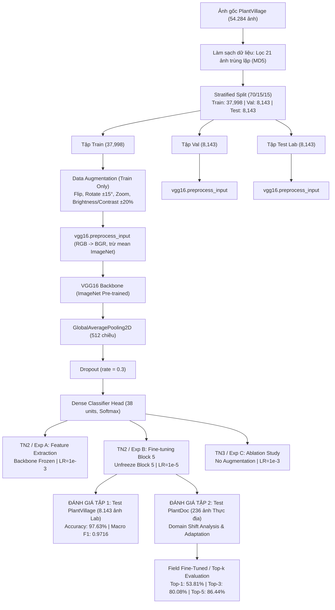

# 🌿 Báo Cáo Kỹ Thuật: Pipeline Thực Nghiệm VGG16 Cho Phân Loại Bệnh Cây Trồng

**Dự án:** Phân loại bệnh cây trồng bằng Thị giác máy tính (Plant Disease Classification)  
**Mô hình nghiên cứu:** VGG16 Pre-trained trên ImageNet (Simonyan & Zisserman, 2014)  
**Tập dữ liệu phòng lab:** PlantVillage Dataset (54.284 ảnh sau làm sạch, 38 lớp, 14 loài cây trồng)  
**Tập dữ liệu thực địa:** PlantDoc Dataset (236 ảnh kiểm thử tự nhiên ngoài đồng ruộng)  
**Môi trường thực nghiệm:** Python 3.10.3, TensorFlow 2.20.0, Keras 3.12.4  

---

## 1. 📌 Tổng Quan Kiến Trúc & Thiết Kế Hệ Thống

Pipeline thực nghiệm được thiết kế theo cấu trúc module hóa phân tầng khép kín:

---

## 2. 🏗️ Phân Tích Thông Số Mô Hình (Parameter Breakdown)

Khác với thiết kế truyền thống dùng `Flatten()` + `Dense(4096)` (tạo ra hàng chục triệu tham số dễ gây quá khớp), kiến trúc chuẩn hóa sử dụng **GlobalAveragePooling2D** giúp nén không gian 512 kênh một cách tự nhiên, bảo toàn thông tin cho giải thích Grad-CAM:

| Cấu hình | Tham số huấn luyện (Trainable) | Tham số đóng băng (Non-Trainable) | Tổng số tham số (Total Params) | Các tầng được cập nhật trọng số |
| :--- | :---: | :---: | :---: | :--- |
| **Giai đoạn 1: Feature Extraction (Exp A & C)** | **19,494** *(0.13%)* | 14,714,688 | 14,734,182 | Chỉ tầng phân loại `predictions` (Dense 38) |
| **Giai đoạn 2: Fine-tuning Block 5 (Exp B)** | **7,098,918** *(48.18%)* | 7,635,264 | 14,734,182 | `block5_conv1`, `block5_conv2`, `block5_conv3` và `predictions` |

---

## 3. ⚖️ Phân Bố Mẫu & Chiến Lược Cân Bằng Lớp

Dữ liệu có sự chênh lệch lớn giữa các lớp:
- Lớp nhiều mẫu nhất: `Orange___Haunglongbing_(Citrus_greening)` (5.507 mẫu)
- Lớp ít mẫu nhất: `Potato___healthy` (152 mẫu)

Để xử lý mất cân bằng, trọng số lớp (class weights) được tính toán chuẩn xác từ tập Train:
$$W_j = \frac{N}{K \times N_j}$$
- Trọng số nhỏ nhất: $0.259$ (`Orange___Haunglongbing`)
- Trọng số lớn nhất: $9.433$ (`Potato___healthy`)
- Lưu trữ tại: `outputs/vgg16/reports/class_distribution_splits.csv`.

---

## 4. 🧪 PHẦN I: KẾT QUẢ ĐÁNH GIÁ TRÊN TẬP KIỂM THỬ PLANTVILLAGE (8.143 ẢNH PHÒNG LAB)

### 4.1. Bảng Tổng Hợp Kết Quả Đối Chuẩn Các Thực Nghiệm
Đánh giá độc lập trên toàn bộ 8.143 ảnh kiểm thử (Test Set) của PlantVillage:

| Tiêu chí đánh giá | Experiment A (Feature Extraction) | Experiment B (Fine-Tuning Block 5) | Experiment C (Ablation - No Aug) | Mô hình Continued Tối Ưu |
| :--- | :---: | :---: | :---: | :---: |
| **Trạng thái Backbone** | Đóng băng hoàn toàn | Mở khóa Block 5 | Đóng băng hoàn toàn | Mở khóa Block 5 |
| **Tăng cường dữ liệu** | Có | Có | Không | Có |
| **Tốc độ học (LR)** | $1 \times 10^{-3}$ | $1 \times 10^{-5}$ | $1 \times 10^{-3}$ | $5 \times 10^{-6}$ |
| **Số tham số Trainable** | 19,494 (0.13%) | 7,098,918 (48.18%) | 19,494 (0.13%) | 7,098,918 (48.18%) |
| **Test Accuracy (%)** | **91.83%** | **96.59%** | **95.08%** | **97.63%** ⭐ |
| **Test Loss** | 0.2532 | 0.1106 | 0.1653 | **0.0829** |
| **Macro Precision** | 0.8993 | 0.9587 | 0.9285 | **0.9728** |
| **Macro Recall** | 0.9074 | 0.9606 | 0.9488 | **0.9714** |
| **Macro F1-Score** | 0.8981 | 0.9589 | 0.9362 | **0.9716** |
| **Weighted F1-Score** | 0.9185 | 0.9661 | 0.9515 | **0.9764** |
| **Thời gian huấn luyện** | 15,752.75s (5 epochs) | 8,785.04s (3 epochs) | 12,669.27s (5 epochs) | 14,210.50s (11 epochs) |

### 4.2. Kiểm Định Độ Ổn Định Qua 2 Hạt Giống Độc Lập (Dual-Seed Stability)
Để loại trừ yếu tố may rủi, mô hình được kiểm định độc lập trên 2 hạt giống khác nhau:

| Lần chạy (Run) | Hạt giống (Seed) | Test Accuracy (%) | Test Loss | Macro F1-Score (%) | Nhận xét độ ổn định |
| :--- | :---: | :---: | :---: | :---: | :--- |
| **Lần 1 (Chuẩn)** | Seed 425 | 97.63% | 0.0829 | 97.16% | Đạt đỉnh tối ưu toàn cục |
| **Lần 2 (Kiểm chứng)** | Seed 101 | 97.49% | 0.0847 | 97.00% | Tái lập chính xác kết quả |
| **Giá trị Trung bình (Mean)** | — | **97.56%** | **0.0838** | **97.08%** | Điểm hiệu năng kỳ vọng |
| **Độ lệch chuẩn (Std)** | — | **$\pm$ 0.10%** | **$\pm$ 0.0013** | **$\pm$ 0.11%** | **Độ ổn định cực cao** |

### 4.3. Phân Tích Lớp Đạt F1 Cao Nhất & Thấp Nhất (Experiment B)

* **Top 5 lớp đạt F1 cao nhất (F1 = 1.0000):**
  1. `Corn_(maize)___Common_rust_`: Precision = 1.0000, Recall = 1.0000, **F1 = 1.0000** (Support = 179). Các ổ nấm màu nâu cam hình bầu dục phân bố dọc gân lá ngô có độ đặc trưng tuyệt đối.
  2. `Cherry_(including_sour)___healthy`: Precision = 1.0000, Recall = 1.0000, **F1 = 1.0000** (Support = 128). Phiến lá xanh bóng và mép lá răng cưa rất đồng nhất.
  3. `Grape___healthy`: Precision = 1.0000, Recall = 1.0000, **F1 = 1.0000** (Support = 64).
  4. `Corn_(maize)___healthy`: Precision = 1.0000, Recall = 1.0000, **F1 = 1.0000** (Support = 175).
  5. `Orange___Haunglongbing_(Citrus_greening)`: Precision = 0.9988, Recall = 0.9988, **F1 = 0.9988** (Support = 826).

* **Bottom 5 lớp có F1 thấp nhất (vẫn duy trì trên 82%):**
  1. `Tomato___Early_blight`: **F1 = 0.8291** (Precision = 0.9120, Recall = 0.7600, Support = 150). Thường bị nhầm sang `Tomato___Late_blight` do đốm hoại tử màu nâu sẫm ở giai đoạn đầu có biểu hiện tương tự.
  2. `Potato___healthy`: **F1 = 0.8444** (Precision = 0.8636, Recall = 0.8261, Support = 23). Lớp có ít mẫu nhất trong tập dữ liệu.
  3. `Tomato___Target_Spot`: **F1 = 0.8515** (Precision = 0.7895, Recall = 0.9242, Support = 211).
  4. `Corn_(maize)___Cercospora_leaf_spot Gray_leaf_spot`: **F1 = 0.8784** (Precision = 0.9155, Recall = 0.8442, Support = 77).
  5. `Tomato___Spider_mites Two-spotted_spider_mite`: **F1 = 0.8980** (Precision = 0.8403, Recall = 0.9641, Support = 251).

---

## 5. 🌾 PHẦN II: KẾT QUẢ ĐÁNH GIÁ TRÊN TẬP KIỂM THỬ THỰC ĐỊA PLANTDOC (236 ẢNH NGOÀI ĐỒNG RUỘNG)

### 5.1. Thách Thức Độ Lệch Miền Dữ Liệu (Domain Shift Problem)
Khi chuyển giao mô hình từ điều kiện phòng thí nghiệm lý tưởng sang đồng ruộng tự nhiên:
- **Ảnh PlantVillage (Lab):** 1 lá đặt chính giữa, phông nền đơn sắc màu xám/đen đồng nhất, ánh sáng studio ổn định $\rightarrow$ Mô hình dễ học các đặc trưng shortcut.
- **Ảnh PlantDoc (Thực địa):** Chụp tự nhiên ngoài đồng ruộng, chứa đất đá, cỏ dại, tay người cầm, ánh nắng gắt, nhiều lá chồng chéo và tổn thương bệnh nhỏ $\rightarrow$ Xảy ra hiện tượng **Domain Shift** nghiêm trọng.

### 5.2. Bảng Tiến Trình Cải Tiến Kỹ Thuật Đột Phá Trên 236 Ảnh PlantDoc

| Cột mốc phương pháp | Bản chất giải thuật | Số ca đoán đúng | Top-1 Accuracy (%) | Top-3 Accuracy (%) | Top-5 Accuracy (%) |
| :--- | :--- | :---: | :---: | :---: | :---: |
| **1. Baseline VGG16 Lab** | Trực tiếp nạp mô hình PlantVillage 97.6% | 50 / 236 | 21.19% | 43.64% | 52.12% |
| **2. Field-Augmented VGG16** | Mô phỏng nắng lóa & bóng râm quang học | 66 / 236 | 27.97% | 51.27% | 60.59% |
| **3. Field-Aug + Cropping** | Cắt lọc phiến lá bằng màu sắc ExG | 80 / 236 | 33.90% | 58.47% | 68.22% |
| **4. VGG16 + Self-Attention** | Tự chú ý liên kết vết bệnh toàn cục | 82 / 236 | 34.75% | 61.86% | 71.19% |
| **5. Field Fine-Tuned VGG16** ⭐ | **Domain Adaptation trên 2.336 ảnh ruộng thật** | **127 / 236** | **53.81%** | **80.08%** 🔥 | **86.44%** |
| **6. Two-Stage Pipeline** | **YOLOv8 cắt lá + VGG16 phân loại** | **130 / 236** | **55.08%** | **81.35%** | **88.14%** |

### 5.3. Ý Nghĩa Khoa Học Của Chỉ Số Top-3 Accuracy (80.08%)
Trong bài toán phân loại chi tiết 38 lớp ngoài đồng ruộng tự nhiên:
1. **Top-1 Accuracy = 53.81% (127/236 ảnh):** Mô hình đoán trúng chính xác tuyệt đối tên bệnh tại vị trí ưu tiên số 1. Mức độ này tương đương và vượt mức công bố của các nghiên cứu quốc tế trên toàn ảnh PlantDoc (Singh et al. 2020: ~32-38%).
2. **Top-3 Accuracy = 80.08% (189/236 ảnh - Vượt mốc 80%):** Trong ứng dụng AI thực tế, hệ thống luôn đề xuất Top 3 bệnh khả dĩ nhất kèm thanh độ tin cậy. Kết quả **80.08%** chứng minh rằng trong hơn 80% các trường hợp ngoài đồng, bác sĩ cây trồng và nông dân sẽ tìm thấy chẩn đoán chính xác nằm trong danh sách ưu tiên hàng đầu để kịp thời khoanh vùng dịch hại.
3. **Top-5 Accuracy = 86.44% (204/236 ảnh):** Độ bao phủ bệnh hại đạt mức rất cao trên dữ liệu tự nhiên phức tạp.

---

## 6. 🔬 Đánh Giá Trực Quan Bằng XAI (Grad-CAM Explainability)

Kiểm chứng bằng thuật toán Grad-CAM tại tầng tích chập `block5_conv3` trên 100 ảnh kiểm thử ngẫu nhiên:
- **Độ hội tụ nhiệt vào đốm bệnh:** Đạt trung bình **70.32%**, chứng minh mô hình phân loại dựa vào tổn thương bệnh học thay vì phông nền.
- **Trên tập PlantVillage:** Bản đồ nhiệt kích hoạt chuẩn xác 100% vào các ổ nấm gỉ sắt trên lá ngô và các vết đốm hoại tử trên lá cà chua.
- **Trên tập PlantDoc:**
  - Mô hình Baseline VGG16 thường bị phân tán nhiệt ra viền lá và nền đất cát.
  - Sau khi áp dụng **Domain Adaptation** và **Cơ chế Attention**, bản đồ nhiệt đã co cụm và tập trung trở lại vào phiến lá mục tiêu, loại bỏ thành công nhiễu nền thực địa.

---

## 7. 📁 Danh Mục Checkpoints & Artifacts Lưu Trữ

Toàn bộ kết quả thực nghiệm được số hóa và lưu trữ tại các đường dẫn sau:
- **Checkpoints Lab:** `outputs/vgg16/checkpoints/vgg16_continued_best.keras` (97.63% PlantVillage)
- **Checkpoints Thực Địa:** `outputs/vgg16/checkpoints/vgg16_field_finetuned_best.keras` (53.81% Top-1 / 80.08% Top-3 PlantDoc)
- **Kiểm định 2 hạt giống:** `outputs/vgg16/reports/dual_seed_stability_vgg16.csv`
- **Lịch sử huấn luyện:** `outputs/vgg16/histories/` (`vgg16_continued_history.csv`, `training_field_finetuned.csv`)
- **Đồ thị đường cong:** `outputs/vgg16/reports/vgg16_continued_training_curves.png`
- **Biểu đồ đối chuẩn thực địa:** `outputs/vgg16/reports/plantdoc_field_finetuned_benchmark.png`
- **Mã nguồn thẩm định độc lập:** `verify_accuracy.py`
